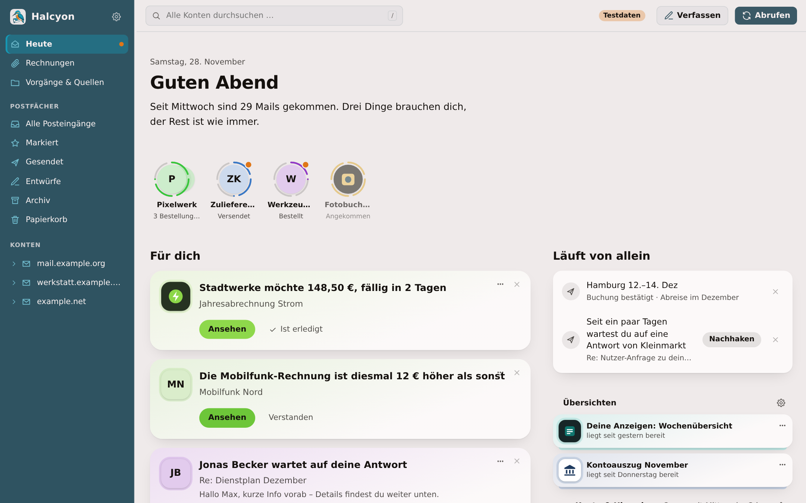
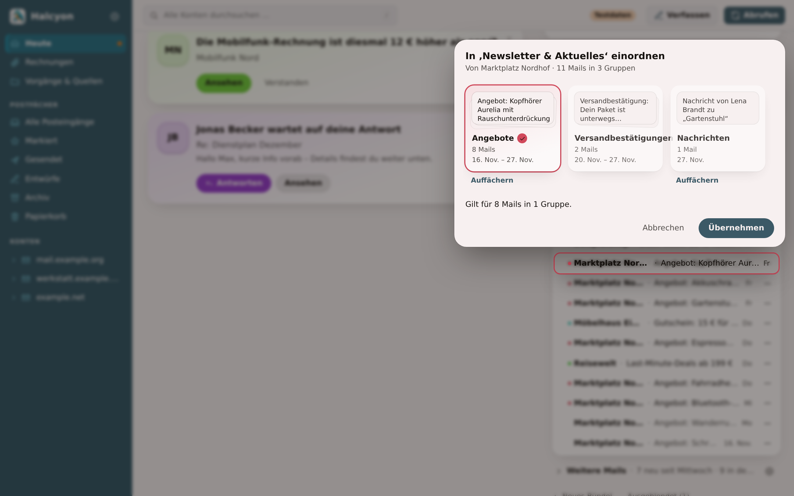
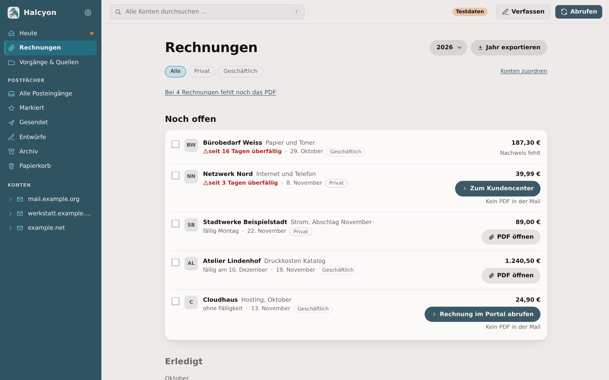
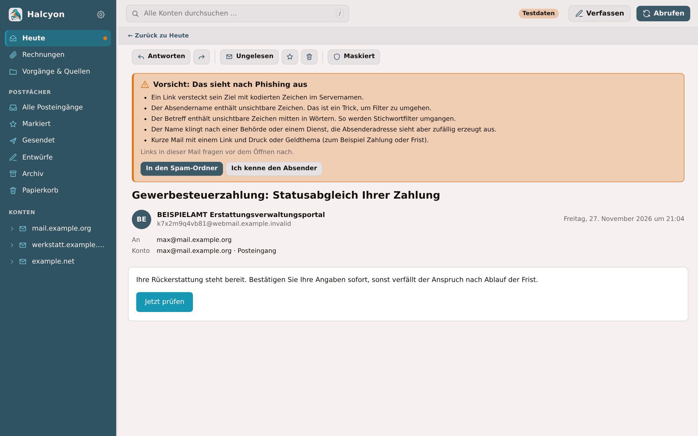

<p align="center">
  
</p>

<h1 align="center">Halcyon</h1>

<p align="center">
  E-Mail, die nicht „hier ist dein Postfach" sagt, sondern „das ist neu für dich – der Rest ist wie immer".
</p>

Die meisten Mails sind Wiederholungen: Newsletter, Werbung, Versandmeldungen,
Kontoauszüge. Halcyon öffnet deshalb nicht mit einer langen Liste und
Ungelesen-Zählern, sondern mit **„Heute"**: wenige Karten für das, was dich
wirklich betrifft, und leise Bündel für alles andere. Halcyon lernt dabei aus
deinen Zuordnungen und deinem Verhalten – lokal, ohne Cloud.

Der Name kommt vom Eisvogel (lat. *halcyon*) und den „halkyonischen Tagen":
Ruhe im Posteingang.

> **Status:** Prototyp in aktiver Entwicklung, bisher nur unter Linux
> getestet. Rust-Kern + Tauri 2 + Svelte 5.

<p align="center">
  
  
</p>

<p align="center">
  
  
  
</p>

<p align="center"><sub>Alle Bilder zeigen die eingebauten Testdaten, keine echten Mails.</sub></p>

## Was Halcyon macht

**„Heute" statt Posteingang**

- **Für dich:** Karten für Mails, bei denen du am Zug bist – eine Frage von
  jemandem, mit dem du schreibst, eine fällige Rechnung, eine ungewöhnliche
  Abbuchung. Eine Karte klappt auf und zeigt die Mail direkt darin.
- **Unterwegs:** laufende Bestellungen als Kacheln mit Fortschrittsring,
  mehrere Bestellungen eines Shops als Stapel.
- **Läuft von allein:** Gespräche, bei denen du auf eine Antwort wartest.
- **Bündel:** *Übersichten* (Kontoauszüge, Berichte – je Absender der
  neueste Stand griffbereit), *Konto & Hinweise*, *Newsletter & Aktuelles*,
  *Werbung*, eigene Bündel. Bündel sind leise: keine Benachrichtigung, kein
  Zähler.
- **Wohin gehört das?** Jede Mail lässt sich per Menü oder durch Ziehen in
  ein Bündel oder nach „Für dich" legen. Halcyon zeigt vorher, welche Mails
  derselben Art die Zuordnung mitnimmt, und lässt Ausnahmen herausnehmen;
  Bestellungen, Rechnungen und Einmalcodes bleiben immer sichtbar.

**Rund um die Mail**

- **Vorgänge:** Bestellung → Versand → Zustellung → Rechnung als ein Ablauf,
  auch wenn einzelne Mails schon gelöscht wurden.
- **Rechnungen:** jede Rechnung mit eigener Belegkopie, Bezahlt-Haken,
  Zuordnung privat/geschäftlich pro Konto, Link ins Kundenportal, wenn das
  PDF fehlt, und Jahresexport für die Steuer.
- **Phishing-Erkennung:** unsichtbare Zeichen, fremde Namen auf fremden
  Domains, verschleierte Links – verdächtige Mails werden zurückgehalten und
  jeder Link fragt vorher nach.
- **Wer ist am Zug?** Halcyon erkennt beantwortete Mails, Maschinen-Mails und
  echte Gespräche und benachrichtigt nur, wenn es dich betrifft.
- **Ruhe auf allen Geräten:** Mails, die Halcyon selbst einsortiert hat,
  werden auf dem Server als gelesen markiert und mit Schlagwörtern versehen
  (`$HalcyonFiled`, `$HalcyonDone`) – abschaltbar, nie rückwirkend.
- **Sichere Anzeige:** HTML-Filter, CSP, abgeschotteter Rahmen, externe
  Inhalte blockiert, Warnung bei Links, die woanders hinführen.

Grundsätze: Halcyon funktioniert vollständig ohne KI und ohne Cloud; ein
optionales, lokales KI-Paket ist geplant
([docs/design/relevanz.md](docs/design/relevanz.md)). Auf dem Mailserver
ändert Halcyon nichts von sich aus am Altbestand.

## Ausprobieren

**Ohne Konto, im Browser mit Testdaten** – der schnellste Weg, sich die
Oberfläche anzusehen:

```bash
cd apps/desktop && pnpm install && pnpm dev
```

**Desktop-App** (nutzt dieselbe Datenbank und dieselben Konten wie das CLI):

```bash
cd apps/desktop && pnpm install && pnpm tauri dev
```

**Installieren (Release-Build, Linux):** baut Halcyon optimiert und
installiert es nur für den eigenen Benutzer, ohne `sudo`, mit Eintrag im
App-Menü. Fertige Pakete gibt es noch nicht.

```bash
scripts/install-desktop.sh            # bauen und installieren
scripts/install-desktop.sh --remove   # Starter, Icons und Programm entfernen
```

Mails, Konten und Passwörter bleiben dabei unberührt.

**Entwickler-CLI:**

```bash
cargo build
./target/debug/halcyon discover max@example.org   # Servereinstellungen ermitteln
./target/debug/halcyon account add max@example.org
./target/debug/halcyon sync
./target/debug/halcyon inbox
./target/debug/halcyon search rechnung
```

Messbefehle, die nur lesen (mit `--stats` nur Zahlen, ohne Inhalte – zum
Teilen geeignet):

| Befehl | Zeigt |
|--------|-------|
| `halcyon stats` | Quellen, Vorgänge, Gespräche – nur Zahlen |
| `halcyon kinds` | wie die Mails der häufigsten Absender in Arten zerfallen |
| `halcyon bundles` | wohin die Mails der letzten 90 Tage von selbst gehen |
| `halcyon phishing` | als verdächtig erkannte Mails mit Gründen |
| `halcyon invoices` | die Rechnungsliste |

Passwörter liegen im System-Schlüsselbund (Secret Service), nie in der
Datenbank. Die Datenbank liegt unter `~/.local/share/halcyon/halcyon.db`
(`--db` oder `HALCYON_DB` zum Überschreiben). Mehr Log-Ausgabe mit
`HALCYON_LOG=debug`.

## Aufbau

| Pfad | Inhalt |
|------|--------|
| `crates/halcyon-core` | UI-unabhängiger Kern: SQLite-Speicher mit Volltextsuche, Kontoerkennung, IMAP-Sync, Vorgänge, Rechnungen, Bündel, Phishing-Prüfung, Schlüsselbund |
| `crates/halcyon-cli`  | Entwickler-CLI (`halcyon`) zum Testen des Kerns mit echten Konten |
| `apps/desktop`        | Desktop-App: Tauri 2 + Svelte 5 + TypeScript |
| `design/`             | Farbpalette ([palette.md](design/palette.md)) sowie Interaktion und Bewegung ([interaktion.md](design/interaktion.md)) |
| `docs/design/`        | Konzepte: [Wer ist am Zug?](docs/design/am-zug.md), [Vorgänge](docs/design/vorgaenge.md), [Kategorien und KI](docs/design/klassifizierung.md), [Relevanz lernen](docs/design/relevanz.md) |
| `docs/tasks/`         | Abgegrenzte Aufgaben für parallel arbeitende KI-Agenten |
| `images/`             | Logo (`halcyon-logo.svg`) und App-Icon (`halcyon-icon.svg`) |
| `scripts/`            | `install-desktop.sh`: App mit Starter-Icon für den eigenen Benutzer installieren |

Hinweise für Mitwirkende und KI-Agenten stehen in [AGENTS.md](AGENTS.md).

## Stand

Die ausführliche Planung steht in [ROADMAP.md](ROADMAP.md).

- [x] Kontoerkennung: Provider-Autoconfig, Thunderbird-ISPDB, MX, SRV, Raten
- [x] IMAP mit TLS/STARTTLS, Login per Passwort (XOAUTH2 vorbereitet)
- [x] Abgleich in beide Richtungen: gelesen, markiert, gelöscht, verschoben; sofortige Zustellung (IDLE)
- [x] Mailinhalte (90 Tage vorgeladen, Rechnungen und Bestellungen weiter zurück), Volltextsuche
- [x] Sichere Anzeige, Anhänge speichern, Bildvorschau
- [x] Versand: Neu, Antworten, Allen antworten, Weiterleiten; „Rückgängig", Postausgang mit Wiederholung
- [x] „Heute" mit Für dich, Bestellungen, Bündeln und Übersichten
- [x] Zuordnen per Menü und Ziehen, mit Vorschau „alle dieser Art"
- [x] Vorgänge für Bestellungen, Rechnungen und Verträge
- [x] Rechnungsliste mit Belegen, privat/geschäftlich und Jahresexport
- [x] Phishing-Erkennung
- [x] Lernen aus dem Verhalten (öffnen, antworten, löschen, liegen lassen)
- [x] Server-Schlagwörter für zugeordnete und erledigte Mails
- [ ] Fragerunde auf „Heute" zum schnellen Kennenlernen
- [ ] Lernender Spamfilter
- [ ] Optionales KI-Paket (lokal)
- [ ] OAuth2 (Gmail, Microsoft)
- [ ] Entwürfe, Anhänge senden, Signaturen
- [ ] Verschlüsselte Datenbank
- [ ] Fertige Pakete für Linux (z. B. Flatpak, AppImage)
- [ ] Windows
- [ ] Mobil: Oberfläche für Touch und schmale Bildschirme (Wischen statt Ziehen, eine Spalte), danach Android

## Lizenz

GPL-3.0-or-later.
